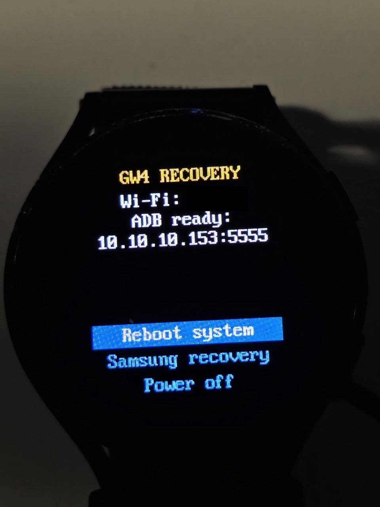

# Galaxy Watch 4 (SM-R870): recovery with root ADB over Wi-Fi

A modified stock recovery for the Samsung Galaxy Watch 4 (SM-R870) that brings up Wi-Fi on its own and exposes a root ADB shell on TCP port 5555. It replaces the Samsung recovery screen with a small status screen that shows the connection state, the address and the signal level, with a button menu.

The point is recovery without opening the watch. The USB pads of the Galaxy Watch 4 are on the main board, and NetOdin (Wireless Download) rejects images that fail Samsung's signature check (SVB). With this recovery any partition can be written with `dd` over Wi-Fi, including the recovery partition itself, while Wireless Download keeps working for stock firmware.



## Status

Verified on an SM-R870, firmware `R870XXS2JZG3`, recovery kernel `5.15.180`:

- The recovery boots, connects to the home network and starts `adbd` as root (`uid=0`, context `u:r:su:s0`) on port 5555.
- The router registers the DHCP host name, so `adb connect gw4-recovery.lan:5555` works.
- A new recovery image was written with `dd` from inside this recovery over Wi-Fi, and its read-back hash matched.
- Wireless Download still starts and accepts a client (reported by the owner; a full NetOdin flash with this recovery has not been tested).

- The fallback access point starts when the home network is not configured, and a phone connected to it with the password from the screen.

Details and hashes are in `docs/STATUS.md`.

## How it works

Wireless Download on this watch is not part of the bootloader. It is the recovery kernel and ramdisk, started with `ro.boot.wirelessd=1`, where the `recovery` binary runs Samsung's `wirelessd` code. The stock recovery ramdisk already contains the Wi-Fi modules, the Broadcom firmware, `mf_supplicant` (Samsung's `wpa_supplicant`), `hostapd`, a DHCP client and server, and `adbd`. This project only adds a few files to that ramdisk:

| File in the ramdisk | Role |
|---|---|
| `system/etc/init/wifiadb.rc` | Starts `wifiadb.sh` on boot and declares the `wifiadb_ui` service |
| `system/bin/wifiadb.sh` | Leaves Wireless Download mode alone; otherwise stops the Samsung UI, starts `gw4ui`, connects to Wi-Fi and enables ADB over TCP |
| `system/bin/gw4ui` | Static ARMv7 program that draws the status screen through the framebuffer and handles the buttons |
| `vendor/etc/wifi/wifiadb-ap.conf` | Base `hostapd` config of the fallback access point; the name and password are added at runtime |
| `prop.default` | `ro.secure=0`, `ro.debuggable=1`, `ro.adb.secure=0`: `adbd` keeps root and asks for no key |
| `sepolicy` | Stock policy plus the rules in `sepolicy/rules.te` |

The kernel, `dtb` and `recovery_dtbo` stay byte for byte identical to the stock image.

### Network

1. Home network: if `/cache/wifi-adb/wpa.conf` exists (`wpa_supplicant` format), the recovery connects to it and gets an address over DHCP. The file is on the unencrypted `cache` partition, so the Wi-Fi password is not part of the image.
2. Fallback: when that file is missing or the connection fails, the watch starts its own WPA2 access point `GW4-RECOVERY-XXXX`. ADB is then on `192.168.49.1:5555`. The suffix (four hex digits, like the `SM-R870-XXXX` of Wireless Download) and the password (`xxxxx-xxxxx`, lowercase letters and digits without look-alikes) are generated on the watch the first time and kept in `/cache/wifi-adb/ap-id` and `ap-pass`, so a laptop can remember the network. The screen shows both. If `/cache` cannot be mounted, a temporary pair is used for that boot. `/cache/wifi-adb/hostapd.conf` overrides the whole config.

ADB needs no key in either mode. Anyone who can reach port 5555 gets root on the watch while it is in this recovery, so the network is the only access control.

The Wi-Fi driver in recovery cannot read the real MAC address and makes up a random one on every boot. Use the host name (`gw4-recovery`) instead of a fixed address.

### Screen and buttons

`gw4ui` shows the status lines written by `wifiadb.sh`, the signal level from `mf_cli signal_poll`, and a menu:

- upper key (`KEY_POWER`): confirm,
- lower key (`KEY_APPSELECT`) or a tap: next item,
- **Reboot system**, **Samsung recovery** (hands the screen back to the stock recovery UI; Wi-Fi ADB keeps running), **Power off**.

The screen turns off after two minutes without input; any key turns it back on.

## Requirements

- Samsung Galaxy Watch 4 (SM-R870) on firmware `R870XXS2JZG3`, with an unlocked bootloader.
- Root on the watch (Magisk) to dump the stock recovery, patch the policy and write the image the first time. One way to get root: [gw4-wireless-root](https://github.com/jmcjm/gw4-wireless-root).
- A Linux computer with `adb`, `lz4`, `unzip` and the Android NDK (r27 used here).
- The Magisk APK, for its x86_64 `magiskboot`.

## Usage

Building and the first flash are described in `docs/BUILDING.md`. In short:

```bash
./build.sh --tools Magisk-v31.1.apk
./build.sh --extract-sepolicy recovery-stock.img sepolicy.stock
sepolicy/patch-sepolicy.sh <adb serial> sepolicy.stock sepolicy.patched
NDK=~/Android/Sdk/ndk/27.0.12077973 ./build.sh recovery-stock.img sepolicy.patched recovery-wifiadb.img
```

Then, with the watch in recovery:

```bash
adb connect gw4-recovery.lan:5555
adb -s gw4-recovery.lan:5555 shell
```

## Repository layout

| Path | Contents |
|---|---|
| `overlay/` | Files added to the recovery ramdisk |
| `ui/gw4ui.c` | Status screen and menu |
| `ui/font.h`, `ui/mkfont.py` | 16×32 bitmap font generated from the `latarcyrheb-sun32` console font |
| `sepolicy/` | Policy rules and the script that applies them with `magiskpolicy` on the watch |
| `build.sh` | Builds the image from a stock recovery image |
| `docs/` | Building and flashing, verified state, lessons learned |

Not in the repository: images (they contain Samsung binaries) and `tools/`. A built image holds no secrets: the Wi-Fi password and the access point identity live on the watch's `cache` partition.

## Limitations

- Only tested on `R870XXS2JZG3`. Another firmware needs its own stock recovery and a freshly patched policy.
- SM-R860 (40 mm): an image for `R860XXS2JZG3` builds from the same sources without changes, from the `recovery.img.lz4` of the `R860XXS2JZG3` AP, with the policy patched by `magiskpolicy` on any rooted watch. It has not been flashed or booted yet. `gw4ui` takes the screen size from the framebuffer, so the 396x396 panel needs no change.
- If the recovery partition is broken, Wireless Download is gone too, because it lives in the same partition. Keep the stock recovery image and write a new image only from a system that boots, or check it from inside a working recovery before rebooting.
- SELinux stays `Enforcing`: the kernel does not allow `setenforce 0`, so the domains involved are made permissive in the policy instead.
- A full stock reflash through NetOdin restores the stock recovery.

## License

GPL-2.0-or-later, see `LICENSE.md` (terms, third-party material, no warranty) and `COPYING` (full license text). The stock Samsung recovery that a built image contains is not covered by it, so built images must not be shared.
